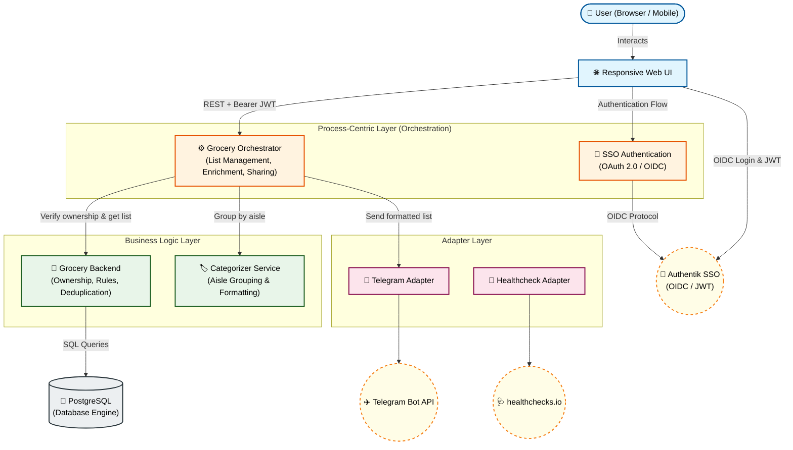

# Grocery List Manager — Final Project Proposal
**Course:** Service Design and Engineering (2026/2027)  
**Team Size:** 2 Students  

---

## 1. Project Overview
The project aims to develop a service-oriented grocery list management application. Users will be able to create, manage, enrich, and share their grocery lists through a responsive Web UI and Telegram.

Each user will only be able to access and manage their own grocery lists (or lists explicitly shared with them). Authentication will be provided through **Single Sign-On (SSO)** via OAuth 2.0 / OpenID Connect, with a strong focus on security, JWT validation, and resource ownership.

The application adopts a strict **4-layer service-oriented architecture**, with independently developed services maintained in separate GitHub repositories, automated via CI/CD pipelines, and deployed reproducibly via Docker Compose.

---

## 2. Architecture and Services

### 2.1 Core Baseline Services (Ordered by Architectural Layer)
Following the reference layered architecture of the course (from top-level presentation down to external dependencies), the baseline system is structured as follows:

| Logical Layer | Component | Responsibility |
|---|---|---|
| 1. User Interface (Client) | Frontend | Responsive Web UI for desktop and mobile devices. |
| 2. Process-Centric Services | Orchestrator Backend | Middleware which receive the client requests and forward them to the proper service. |
| 3. Process-Centric Services | Single Sign-On Authentication | Handles authentication workflow via OAuth 2.0 / OpenID Connect. |
| 4. Database (Infrastructure) | PostgreSQL | Relational database engine for data persistence (accessed directly by Grocery Backend). |
| 5. Adapter to External Service | Telegram Adapter | Integrates with the Telegram Bot API to send formatted grocery lists. |
| 6. Adapter to External Service | Healthcheck Adapter | Sends heartbeat and failure signals to healthchecks.io. |
| 7. External Services | SSO Provider (Authentik) | Provides identity management, OAuth 2.0 / OIDC authentication, and JWT issuance. |
| 8. External Service | Telegram Bot | Self-developed Telegram Bot. |

---

### 2.2 Process-Centric Services Explanation
According to the course requirements for a **2-student team**, we must implement **at least 2 distinct Process-Centric Services**, and **each must compose approximately 3–4 lower-level services** to fulfill a complete user request. 

Our two main process-centric services are:

* **Grocery Orchestrator**: Manages the complete grocery list lifecycle including creation, modification (add, edit, delete items), enrichment via categorization, and sharing via Telegram. This service internally integrates:
  * **Grocery Backend** (Business Logic Layer): Core grocery list operations, business rules, deduplication, and ownership checks. Connects directly to PostgreSQL for all persistence operations.
  * **Categorizer Service** (Business Logic Layer - internal component): Stateless rule-based categorization that classifies grocery items into standard supermarket aisles (*Dairy, Produce, Household, Bakery, Other*), calculates item totals per category, and formats clean summaries for display or Telegram export
  * **Telegram Adapter** (Adapter Layer): Integration with Telegram Bot API for sharing formatted lists
  * *(Optional)* Persistent favorites list feature where deleted items are not permanently removed from the database, allowing users to quickly re-add frequently purchased items

* **Single Sign-On Authentication**: Handles the complete authentication workflow via OAuth 2.0 / OpenID Connect, managing user sessions, JWT validation, and secure access control across all services.

---

## 3. Architecture & Workflow Diagram

The following diagram illustrates the strict top-down layered architecture, showing how the UI communicates with the Process-Centric layer, which in turn orchestrates Business Logic, Data, and Adapter services.

---

## 4. Workflow: Grocery Orchestrator — Categorized Grocery Management & Sharing

The **Grocery Orchestrator** is our primary process-centric service that composes multiple lower-level services to fulfill complete user requests for grocery list management.

### Core Functionality
* **Lower-Level Services Composed (3 services):**
  1. **Low-Level Service 1 — `Grocery Backend` (Business Logic):** Verifies JWT ownership of the requested grocery list, validates sharing rules, handles item modifications (add, edit, delete), and manages all persistence operations directly against PostgreSQL — including retrieval of list items, user's Telegram Chat ID, updates to `last_shared_at` timestamp, and the favorites/persistent items feature.
  2. **Low-Level Service 2 — `Categorizer Service` (Business Logic):** Groups the grocery items by supermarket department (*Produce, Dairy, Bakery, Household, Other*) and calculates item totals.
  3. **Low-Level Service 3 — `Telegram Adapter` (Adapter):** Sends the cleanly formatted, aisle-organized list to the user's Telegram chat via the Telegram Bot API.

### How It Works
When a user interacts with their grocery list through the Web UI (creating items, modifying them, deleting them, or clicking *"Share Organized List on Telegram"*), the `Grocery Orchestrator` coordinates the entire process:

1. **Authentication & Ownership**: First ensures the user owns the list via `Grocery Backend` and JWT validation
2. **Data Operations**: Retrieves or modifies list items through the `Grocery Backend`
3. **Categorization**: Passes items to the `Categorizer Service` for organization by supermarket aisle (making shopping easier)
4. **Sharing**: When requested, triggers the `Telegram Adapter` to deliver the formatted message
5. **Persistence**: Records sharing timestamps and maintains item history in the database

### List Modification Features
The orchestrator supports complete CRUD operations on grocery items:
* **Add items**: New products are added to the active list
* **Edit items**: Modify product names, quantities, or categories
* **Delete items**: Remove items from the active list *(Note: Items can be marked as "favorites" and persist in the database even after deletion, allowing users to quickly re-add frequently purchased items without permanent data loss)*

---

## 5. Authentication and Security
Authentication is handled via **OAuth 2.0 / OpenID Connect (OIDC)** using a dedicated **Authentik** instance.

* **Login Flow:** Users authenticate directly against Authentik and receive a signed **JWT (JSON Web Token)**. The Web UI never handles raw passwords.
* **JWT Validation:** Every protected microservice validates incoming `Authorization: Bearer <JWT>` headers by verifying the cryptographic signature against Authentik's public keys, checking expiration (`exp`), and extracting the user identifier (`sub`).
* **Resource Ownership Enforcement:** The `Grocery Backend` enforces strict ownership rules—users can only read, modify, share, or delete grocery lists where they are registered as the owner (or authorized collaborator).
* **Infrastructure Security:**
  * Internal services (`Categorizer`, `Adapters`) are isolated within the internal Docker network and are not exposed directly to the public host when not required.
  * Sensitive credentials (Telegram Bot Token, DB passwords, Authentik secrets, `healthchecks.io` UUIDs) are injected via environment variables / Docker secrets.

---

## 6. Technologies, CI/CD, and Deployment

| Category | Technology | Role in the Project |
| :--- | :--- | :--- |
| **Database** | PostgreSQL | Relational database engine for data persistence. |
| **Frontend** | Responsive Web UI | Desktop and mobile interface integrated with Authentik OIDC. |
| **Authentication** | Authentik | OpenID Connect SSO provider. |
| **External APIs** | Telegram Bot API, healthchecks.io | External integrations encapsulated behind dedicated Adapter services. |
| **CI/CD** | GitHub Actions | Runs automated unit/integration tests and builds Docker images on every push/PR. |
| **Container Registry** | GitHub Container Registry (GHCR) | Hosts versioned Docker images (`ghcr.io/<org>/<service>:latest`) built by CI. |
| **Deployment** | Docker & Docker Compose | Single-command reproducible orchestration (`docker compose up -d`) pulling from GHCR. |

---

## 7. Testing, Documentation, and Expected Deliverables

### 7.1 Automated Testing
Each service repository includes automated tests executed by **GitHub Actions** prior to image publishing:
* **Unit Tests:** Business logic rules, categorization, deduplication, and input validation.
* **Integration & Contract Tests:** REST API request/response structures and service-to-service communication.
* **Security Tests:** JWT validation (rejecting expired/invalid tokens) and grocery list ownership enforcement (`403 Forbidden` on unauthorized access).
* **End-to-End Workflows:** Complete tests for the two Process-Centric orchestration scenarios.

### 7.2 Documentation & Final Deliverables
* **Multi-Repository Organization:** Every service lives in its own repository inside the GitHub organization (`grocery-frontend`, `grocery-orchestrator`, `grocery-sso-service`, `grocery-backend`, `grocery-categorizer`, `grocery-telegram-adapter`, `grocery-healthcheck-adapter`). Each repository has its own CI/CD pipeline that tests the service and publishes its image to GHCR.
* **Deployment Repository (`grocery-deploy`):** This repository contains the root `docker-compose.yml` (pulling the service images from GHCR), the database init scripts under `db/init/`, `.env.example`, and the configuration instructions.
* **OpenAPI / Swagger Specifications:** Full API documentation for every REST service, including request/response schemas and representative JSON examples.
* **Published Containers:** Ready-to-run Docker images hosted on **GHCR**.
* **Technical Report (Max 3 Pages):** Concise document covering problem statement, layered architecture diagram, the two Process-Centric orchestration workflows (Grocery Orchestrator and SSO Authentication), external services, and reproducible deployment instructions.
* **Live Demonstration:** End-to-end live execution during the exam session showcasing SSO login, ownership enforcement, list modification capabilities (add, edit, delete with favorites persistence), categorization, and Telegram sharing workflow.
